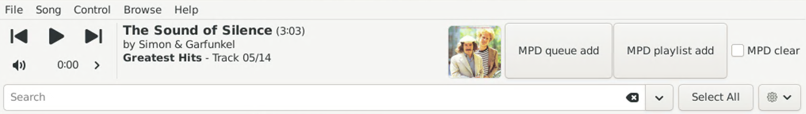

# Export tracks to MPD - Quod Libet plugin

## Summary

This is a plugin for [Quod Libet](https://github.com/quodlibet/quodlibet).
 It allows to export the Quod Libet current track list, or current selected tracks if any, to MPD.
 Use case: You love MPD ecosystem ? But you miss the capability to natively manage your own user-created tags, embedded in the audio files ?
-> This plugin is for you.
 It allows to use Quod Libet powerful handling of any tag (advanced search engine, tag editing), then, once you have filtered and/or selected the tracks you want to play,
- Button "MPD queue add" performs addition of these tracks to the MPD queue
- Button "MPD playlist add" performs addition of these tracks to MPD playlist "Filtered playlist"
- Checkbox "MPD clear" performs cleanup of the queue or playlist before addition

## Pre-requisites

- Quod Libet
- PyGObject (gi module) python libs
- python-mpd2 python lib

## Installation

- Copy file 'export-tracks-to-mpd.py' into Quod Libet plugins directory (typically, ~/.config/quodlibet/plugins/).
- Restart Quod Libet, go to File -> Plugins, and check (enable) the plugin 'Export to MPD'.

## Usage

Use Quod Libet normally, browsing & searching for tracks, in order to populate the active track list.
Moreover, you can optionally select a subset of the active tracks.
Once satisfied with the track list (full track list, or selected subset), now you can perform export of these tracks to MPD:
- (a) If your intent is to start over from scratch (replacing any existing contents), check the "MPD clear" checkbox ; otherwise leave it unchecked
- (b) If your intent is to populate the play queue, click on Button "MPD queue add" -> This performs addition of the tracks to the MPD play queue
- (c) If your intent is to populate a playlist, click on button "MPD playlist add" -> This performs addition of the tracks to MPD playlist "Filtered playlist"

You can further iterate browsing + (b) or (c) for adding more tracks into MPD (queue or playlist), until all expected tracks are added. 

Then, use your regular MPD client (on smarpthone or computer):
- The queue (or playlist) is there, as just populated.
- Use the MPD client normally, e.g. to start playing the tracks.

## Notice

This (modest) software was (modestly) coded with the help of AI.

## Legal

This software is released under [Mozilla Public License 2.0](https://www.mozilla.org/en-US/MPL/2.0/), see [LICENSE](LICENSE).
